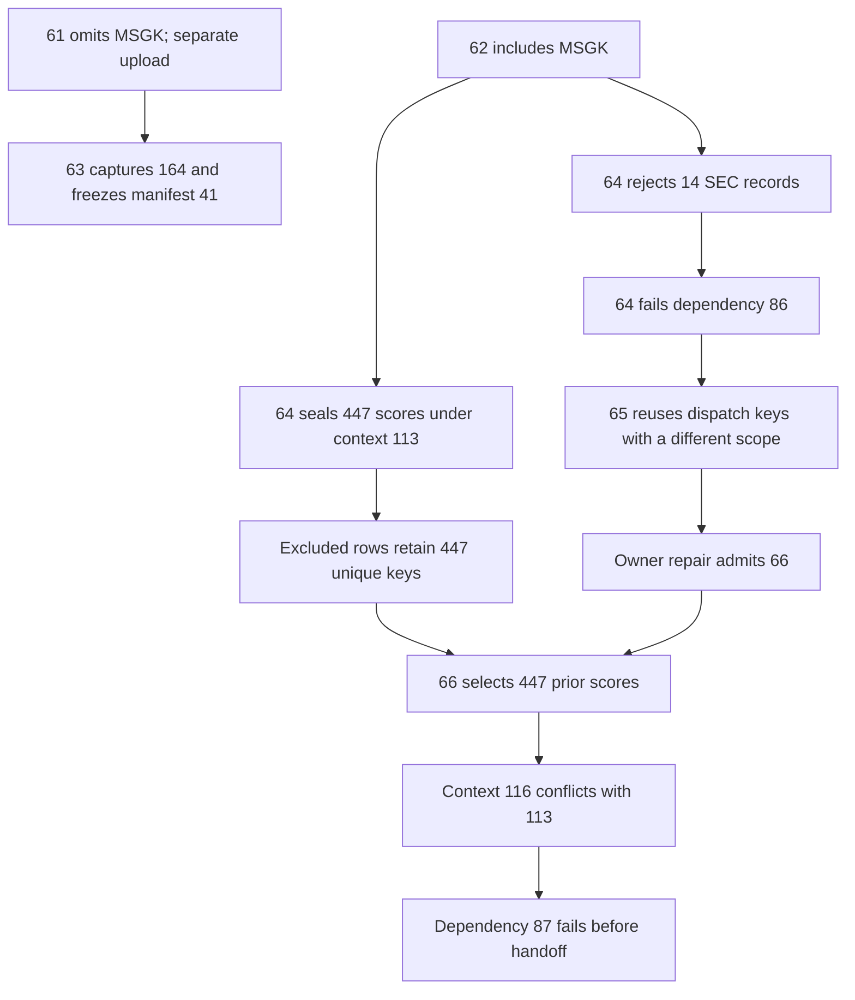

# SwingLens regression forensics • 16 November 2026
All narrative times are Zürich CET. See evidence.json for exact timestamps, full hashes, job relationships and per-ticker immutable score identities. queries.sql contains the SQL which produced those results. Job log extracts explicitly carry UTC timestamps.

## Timeline and causal findings
|Upload / pipeline|Local execution interval|Runtime|Main / CERI context|Outcome|
|---|---|---|---|---|
|61 / 63|Nov 13 22:22:22 – Nov 14 02:38:38|2af1e7d|110 / 111|All 13 steps completed, parent PARTIAL, NO_INTEGRITY_HAZARD. Root 2128, SEC dependency 83, continuation 2130; CERI capture 2180, dependency 84, continuation 2183. Manifest 41 at 00:41:30 contains all 164 scores 6325–6488.|
|62 / 64|Nov 14 13:01:32 – 19:35:47|2af1e7d|112 / 113|Root 2184, SEC dependency 85, continuation 2186. Job 2291 partial at 18:21:15. Job 2305 completed at 19:29:54 with 447 sealed scores 6936–7382. Dependency 86 failed; parent PARTIAL.|
|62 / 65|Nov 15 13:29:12 – 14:38:39|7e113f7|114 / none|Root job 2308 failed at bind_semantic_authority; no durable CERI dependency or capture.|
|62 / 66|Nov 15 19:33:49 – Nov 16 00:23:39|6d6952f|115 / 116|Root job 2427. 72 provider batches, 36 normalize, 9 feature and finalizer 2545 completed. Capture 2546 failed; dependency 87 failed, zero scores for context 116 and no continuation.|

**CONFIRMED.** The uploads differ by content and identity. Upload 61 had 164 symbols, upload 62 had 447; 104 overlap, 60 are exclusive to 61, 343 to 62. MSGK occurs only on 62. On pipeline 64, processing 27590 rejected all 14 MSGK records, IDs 219365–219378. SEC CIK 0001636519 matched historical MSGS company 171 and MSGK company 793. This collision existed before pipeline 63. The other 120 workflow jobs completed. The partial normalization prevented handoff even though capture sealed 447 scores. Those rows remained physically present after exclusion. Upload 61 had its own upload key, one execution and no conflicting earlier population in the surviving score history. Coverage included 37 incomplete rows. Its 164 terminal dispositions arrived at 02:38:38, after its historic handoff. Today combined eligibility returns zero for both uploads. That result cannot reconstruct what manifest 41 contained at freeze.

**CONFIRMED.** Commit 7e113f7 at Nov 14 21:08:15 was activated at 22:10:16. Scoped historical repair 28303 completed at 22:10:28. Receipt records 14 normalized, zero quarantined, 14 events and zero scoring-eligible. The patch added reviewed symbol succession and effective-date matching, CIK safeguards on writers and readiness, bounded replay, rejection diagnostics and tests. It retained upload/config-based scheduling. Pipeline 65 collided with another scope during dispatch. Job 2187 is the first prior provider key in this workflow. The exception does not record the exact child ID. A second set of 447 exclusions was recorded on the old scores during 65's terminalization.

**CONFIRMED.** Commit 6d6952f at Nov 15 15:04:28 started at 15:52:22 and restarted at 19:17:52. It gives new workflows an owner-qualified key, preserves retained workflow keys, returns the actual scheduling plan to the caller and restricts failed-parent containment/processing cleanup. Its repeat-upload test and rolled-back rehearsal validated dispatch; its handoff qualification exercised a fresh 159-company population. It did not change score uniqueness, capture selection, identity derivation or eligibility fallback. Its narrower containment introduces a residual gap: when several pipelines share an upload, an ownerless newly produced row cannot qualify for containment by the sole-pipeline branch.

**CONFIRMED.** All captures used the Nov 13 session, swinglens-us-equities-v2, the same configuration hash and frozen anchor, and ceri-1.3.0. The three post-acquisition contexts froze respectively at Nov 14 00:07:25.202315, Nov 14 18:38:59.036197 and Nov 15 23:57:34.652245. They differ from main enqueue contexts. Every sealed score on uploads 61 and 62 carries KNOWN upload and UNKNOWN pipeline ownership. The worker job payload and the parent's retained CERI context give the true owner; the capture code loses it by consulting only the main-context pipeline FK.

## Read-only counterfactual
Using the production resolver, the stored job anchor and native contextual.ceri adapter, replay.py calls the deployed existing-score helper inside a PostgreSQL read-only transaction. A separate per-row compatibility check rejects 447/447. The exception matches the worker and identifies context ID, context fingerprint and precise cutoff. All three revisions reject the same persisted candidates. Default local configuration is an invalid substitute for the frozen job configuration. This isolates source revision from persisted-state effects without invoking a writer or a pipeline.

## Git attribution
|Behavior|First meaningful change on release lineage|
|---|---|
|Four-part uniqueness|0cb82e1 on Aug 1 in the model, 4a9769f on Aug 2 in the migration. Live index is unique on run_id (upload), company_id, config_hash and calculation_version.|
|Bulk snapshot candidate lookup|8e56c8d on Aug 8. It applies exactly those dimensions.|
|Original queue key|cc0610a on Aug 12. Upload plus config was insufficient for independent owners.|
|Handoff selection|a7cbb3b on Sep 13 filters by upload, 3a9d470 adds eligibility.|
|Strict compatibility and owner derivation|fc38050 on Sep 14 introduced the compatibility check and owner lookup from context FK. 6884b0d on Sep 16 owns current call sites under whitespace-aware blame.|
|Separate CERI freeze with null owner FK|6f3adef on Sep 29. Its resolver expects null and validates the reverse binding on pipeline.result_json.|
|Unsuccessful-sibling fallback|36674d1 on Sep 30; aeb0ef4 refines safe partial handling on Oct 21.|
Ordinary blame attributes some reformatted lines to e3ca62d; whitespace-aware blame and original diffs distinguish semantic introductions. The attached patches include both recent commits in full, with every changed application, script and test file.

## Release provenance
Worker log records associate actual job IDs with all three full Git SHAs. These are the only two Git edges between the deployed baseline and job 2546. All three release trees are clean including nonignored untracked files. Every application Python file is tracked. Normalized qualification source hashes matched 1269/1269, 1271/1271 and 1271/1271. The primary checkout at 3a78cfb contains unrelated tracked changes (153 diff-stat entries), untracked sources and an untracked launcher. Launcher backups select the respective releases. Its status is not runtime provenance. checkout-audit.txt identifies the working-tree differences, launcher switches and normalized receipt results. GitHub could not resolve either abbreviated repair SHA in ivobog/swing-lens. NOT VERIFIED: publication to any other remote, authorship/time of unrelated dirty changes, or historical transient edits reverted before inspection.

## Causal dependency graph

## Smallest coherent remediation
1. Align candidate selection and database uniqueness around the exact frozen canonical calculation, including context, company, configuration and calculation version. Retain same-context fail-closed identity validation, same-owner retry idempotence and concurrent uniqueness. Preserve distinct rules for legacy NULL contexts and controlled replay. Ignoring the exception would collide with 447 occupied keys; accepting the old scores yields zero certified tickers under 116.
2. Reuse the existing pipeline-to-CERI-context binding to propagate a verified owner into new capture/evidence, eligibility and containment. Fail closed for ambiguous legacy records. Setting the existing FK directly would violate UNIQUE(pipeline_run_id) because the main context already uses it, and the CERI resolver explicitly expects NULL. Do not rewrite old sealed UNKNOWN identities.
3. Use the same exact eligible, evidence-backed population for current change/alert work, the barrier, manifest freeze and verification. Keep valid historical comparator selection separate. The barrier counts distinct tickers with evidence by upload/context; the manifest reader and validator enumerate eligible scores by upload only. The owner predicate passes 0/447 for 62 today even before explicit dispositions. Two eligible contexts could mix and trigger a ceri_cutoff lineage error; zero eligible rows could escape the per-row validator. Require set equality, single score per ticker, valid context, configuration, cutoff, calendar and source-record timing. Current presentation also tests quarantine/retirement across upload siblings; this is a separate serving issue.
4. Preserve workflow completion, active-parent and configuration-anchor checks. All required child jobs must complete, context-specific certified coverage must match the upload, and a correctly bound continuation must close the dependency. Validate on a disposable copy with a prior failed owner, a prior successful owner, same-owner and concurrent retries, controlled replay and ambiguous legacy rows. Prove all 447 new IDs reach the change/alert tail and manifest and preserve all old evidence and dispositions. Keep an intentionally incompatible same-context negative control.

**INFERRED.** A lookup-only change would move the failure to insertion or allow incomplete/mixed downstream evidence depending on the attempted fix. Storage collisions are proved by the actual index and keys. The hypothetical corrected writer and downstream manifest were not executed.

**NOT VERIFIED.** Completion of a future corrected capture, financial tail, or unrelated data-dependent downstream checks. Historical run 66 is terminal. No production schema, code, pipeline state or historical evidence was changed, and no full pipeline was started.